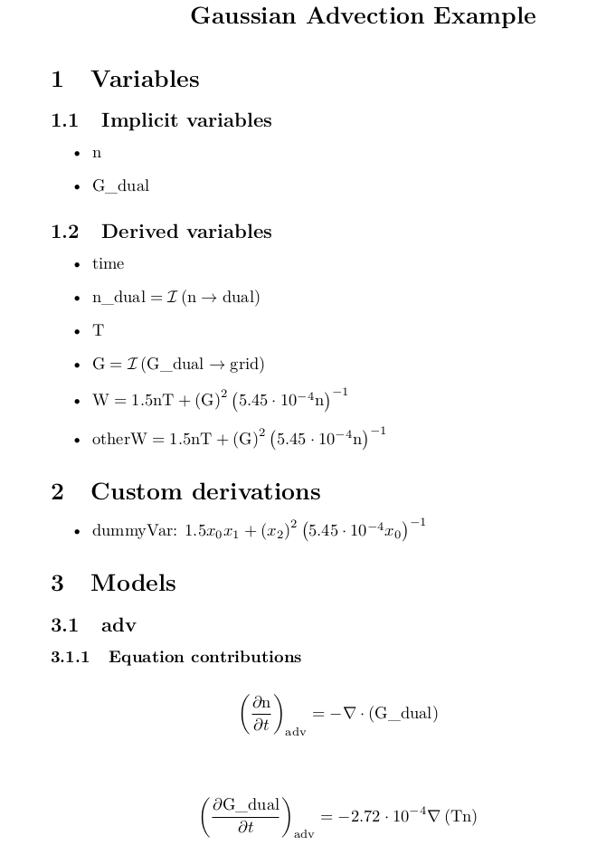
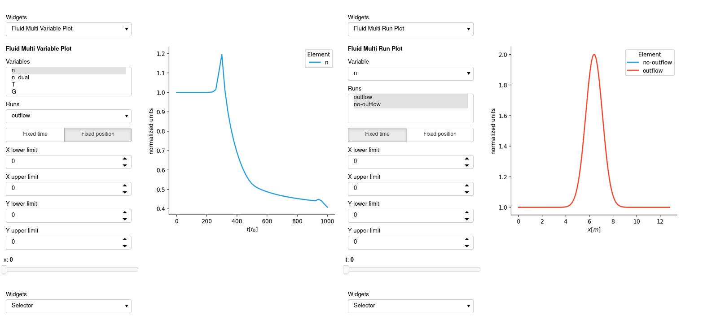

<p align="left">
    <picture>
      <source media="(prefers-color-scheme: dark)" srcset="https://github.com/ukaea/ReMKiT1D/blob/master/logos/thumbnail_ReMKiT1D_white.png">
      <source media="(prefers-color-scheme: light)" srcset="https://github.com/ukaea/ReMKiT1D/blob/master/logos/thumbnail_ReMKiT1D_black.png">
      
    </picture>
</p>

# ReMKiT1D Python support - v2.1.0

[](https://github.com/ukaea/ReMKiT1D-Python/actions/workflows/pytest_action.yml)
[](https://github.com/ukaea/ReMKiT1D-Python/actions/workflows/code_quality.yml)
[](https://codecov.io/gh/ukaea/ReMKiT1D-Python)
[](https://remkit1d-python.readthedocs.io/en/latest/?badge=latest)
[](https://pypi.org/project/RMK_support/)
[](https://pypi.org/project/RMK_support/)
[](LICENSE.md)

Contact: stefan.mijin@ukaea.uk

Logo credits: Vera Oberhauser

## Overview

`RMK_support` is a collection of tools designed to configure and analyze ReMKiT1D runs. [ReMKiT1D](https://github.com/ukaea/ReMKiT1D) is a framework for building multi-fluid models in 1D with reaction and kinetic electron support, aimed primarily at simulating the tokamak Scrape-Off Layer.

ReMKiT1D runs use JSON files to configure the models and methods used by the code, and `RMK_support` provides convenient Python routines for generating these config files as well as analyzing simulation data obtained from ReMKiT1D runs.

For a high-level overview of the framework and the (pre-v2.0.0) Python interface see the [code paper](https://doi.org/10.1016/j.cpc.2024.109195). For detailed documentation of the Python package see [Read the Docs](https://remkit1d-python.readthedocs.io/en/latest/).

## Prerequisites

All routines require **Python >= 3.11**, with the following runtime dependencies (installed automatically by `pip`):

1. `numpy`
2. `xarray`
3. `holoviews`
4. `panel`
5. `param`
6. `matplotlib`
7. `h5py`
8. `scipy`
9. `pylatex`

> **_NOTE_**: `RMK_support v2.1.0` is paired with **ReMKiT1D v1.4.0** (which requires PETSc >= 3.17 and SUNDIALS >= 7.0). Key v2.1.0 / v1.4.0 alignment notes:
> - Updated PETSc/BDE defaults (`reusePreconditioner`, `andersonDepth`), removal of the legacy HYPRE `"euclid"` preconditioner override, and omission of zero initial values for derived variables.
> - `MatrixTerm(..., skipPattern=...)` and `.withSkippingPattern()` are deprecated and emit `DeprecationWarning` (support was removed in ReMKiT1D v1.4.0).
> - Adds `CRMModelboundData(energyInterpolationGrid=...)` and the `filterWithin(node, lowerBound, upperBound)` calculation-tree operation.
> - For older ReMKiT1D cores (v1.2.1–v1.3.x), use `RMK_support v2.0.x`.

In order to use the PyLaTeX PDF generation features, a `latexmk` and TeX Live installation is required. See the [PyLaTeX documentation](https://jeltef.github.io/PyLaTeX/current).

## Installation

`RMK_support` is installable from PyPI via `pip`:

```bash
pip install RMK_support
```

Alternatively, especially when working with development branches or contributing, install directly from the repository root:

```bash
pip install .
# Or editable install with development and documentation extras:
pip install -e ".[dev,docs]"
```

## Testing

The test suite can be run directly with `pytest` from the repository root (the `examples/` directory is automatically added via `pyproject.toml`):

```bash
pytest
```

Or via the helper wrapper script (which forwards all CLI arguments to `pytest`):

```bash
bash ./test.sh
```

To skip tests requiring a local LaTeX/`latexmk` installation, pass `--exclude_latex_tests`.

## Repository structure

The package files live in `RMK_support/`, together with the unit test suite in `RMK_support/tests/`.

The `tutorials/` directory contains basic tutorial notebooks, which are also included in the [Sphinx documentation](https://remkit1d-python.readthedocs.io/en/latest/).

The `examples/` directory contains both general examples for problems relevant to SOL physics and verification tests reported in the code paper, written using the v2.x syntax.

The `data/` directory contains atomic data used by some of the examples, in particular spontaneous emission rates for hydrogen obtained from NIST (see the [CRM example](https://github.com/ukaea/ReMKiT1D-Python/blob/master/examples/crm_0D.ipynb) notebook). **This directory should contain the `amjuel.tex` file from the EIRENE AMJUEL database in order to run some of the examples! This file is NOT distributed with the repository.**

## High-level workflow

This package was rewritten for v2.0.0 as a Python Domain Specific Language for constructing ReMKiT1D models, and refined in v2.1.0.

Below we include the Gaussian advection example from `examples/` almost verbatim to showcase the main workflow on a simple problem.

For explanations of the terminology used (nodes, implicit/derived variables, staggered grids, matrix terms, etc.) see the [code paper](https://doi.org/10.1016/j.cpc.2024.109195).

### Advection example

Imports for the advection example:

```python
import RMK_support as rmk
from RMK_support import node
from RMK_support.stencils import StaggeredDivStencil as Div, StaggeredGradStencil as Grad

import numpy as np
```

The main Python object is `RMKContext`, which centralises the definition of ReMKiT1D simulations. Below we construct it and set the IO and MPI options for the example:

```python
rk = rmk.RMKContext()
rk.IOContext = rmk.IOContext(HDF5Dir="./RMKOutput/RMK_advection_test/")
rk.mpiContext = rmk.MPIContext(numProcsX=4)
```

We set the grid component of the context to a simple uniform spatial grid:

```python
xGridWidths = 0.025 * np.ones(512)
rk.grid = rmk.Grid(xGridWidths, interpretXGridAsWidths=True)
```

By default, ReMKiT1D supports staggered spatial grids, with some quantities living on cell centres (the regular grid) and others on cell edges (the dual grid). The Python module provides helpers for constructing variable pairs, automatically configuring linear interpolation for the dual counterpart.

Here we set the initial conditions and add variables to the context:

```python
nInit = 1 + np.exp(-(rk.grid.xGrid - np.mean(rk.grid.xGrid)) ** 2)  # A Gaussian perturbation
TInit = np.ones(len(rk.grid.xGrid))  # Constant temperature

n, n_dual = rmk.varAndDual("n", rk.grid, data=nInit)  # both variable and its dual
T = rmk.Variable("T", rk.grid, data=TInit, isDerived=True, isCommunicated=False)
G_dual, G = rmk.varAndDual("G", rk.grid, primaryOnDualGrid=True)  # first return value is the primary (dual here)

rk.variables.add(n, n_dual, T, G_dual, G)
```

In ReMKiT1D terminology, the above adds the implicit variables `n` and `G_dual`, while `n_dual` is a derived variable interpolated from cell centres to edges, and `G` is interpolated from edges to centres.

#### Expression tree node arithmetic

ReMKiT1D translates elementary Python expressions into derived variables using calculation trees. Variables can be transformed into nodes and vice versa via `node` and `varFromNode`, allowing concise variable arithmetic:

```python
massRatio = 1 / 1836

W = rmk.varFromNode(
    "dummyVar",
    rk.grid,
    node=1.5 * node(n) * node(T) + node(G) ** 2 / (node(n) * massRatio),
)
rk.variables["W"] = W  # copies and renames the variable to "W" when added
rk.variables.add(W.rename("otherW"))  # alternative explicit rename
```

Before normalisation, the advection equations solved in this example are:

$\frac{\partial n}{\partial t} = - \frac{\partial u}{\partial x}$

$m_i \frac{\partial u}{\partial t} = - \frac{\partial (nkT)}{\partial x}$

```python
model = rmk.Model(name="adv")

# Models have ddt components, representing individual contributions to equations
# Matrix terms can be automatically constructed by invoking stencils

model.ddt[n] += -Div()(G_dual).rename("div_G")
model.ddt[G_dual] += -massRatio / 2 * Grad()(T * n).rename("grad_p")  # rightmost variable (n) is implicit

rk.models.add(model)
```

In the above we use stencils to construct `MatrixTerm` objects and `rename` to label terms inline. Stencils can also act on multiplicative combinations of variables. More complex term constructions (spatial profiles, modelbound variables, time signals, etc.) are demonstrated in the `examples/` directory.

Time integration is configured via `IntegrationStep` and `IntegrationScheme` objects:

```python
# Implicit BDE integrator checking convergence on n and G_dual
integrator = rmk.BDEIntegrator("BDE", nonlinTol=1e-12, absTol=10.0, convergenceVars=[n, G_dual])

integrationStep = rmk.IntegrationStep("BE", integrator)
integrationStep.add(rk.models)  # Add all models in context

rk.integrationScheme = rmk.IntegrationScheme(dt=0.1, steps=integrationStep)
rk.integrationScheme.setFixedNumTimesteps(10000, 200)  # Run for 10000 steps, outputting every 200
```

With the above, the context is ready to write a ReMKiT1D JSON configuration file:

```python
rk.writeConfigFile()
```

#### LaTeX simulation summaries

`RMK_support` supports automatic generation of PDF summaries using PyLaTeX:

```python
rk.generatePDF("Gaussian Advection Example")
```

The first page of the summary then looks like:


> **_NOTE_**: In the above example no attempt has been made to remap variable names to LaTeX symbols. Pass `latexRemap` to `generatePDF` with a dictionary of `{variable_name: latex_string}`, for example `{"G_dual": r"\vec{\Gamma}_{dual}"}`, to render `G_dual` as $\vec{\Gamma}_{dual}$. Similar remapping options exist for model names and constants.

### Data analysis and visualization

The secondary feature of `RMK_support` is data analysis and visualization, powered by `xarray` datasets with interactive dashboards built on `holoviews` and `panel`.

Composable dashboards are constructed through `ElementDisplay` objects and served as a [Panel](https://panel.holoviz.org/) app. For example, running the cell below in the [advection with outflow](https://github.com/ukaea/ReMKiT1D-Python/blob/master/examples/gaussian_advection_outflow.ipynb) notebook after running the [Gaussian advection](https://github.com/ukaea/ReMKiT1D-Python/blob/master/examples/gaussian_advection.ipynb) example serves the pre-built comparison dashboard:

```python
from RMK_support.dashboard_support import dashboard

runPaths = {"outflow": rk.IOContext.HDF5Dir, "no-outflow": "./RMKOutput/RMK_advection_test/"}
plt.rcParams["figure.dpi"] = 150
hv.output(size=50, dpi=150)
dashboard(rk, runPaths=runPaths, elementsPerTab=2).servable().show()
```



## Documentation, examples and tutorials

For a high-level explanation of both the framework and the interface, see the [ReMKiT1D code paper](https://doi.org/10.1016/j.cpc.2024.109195).

The notebooks and scripts in `examples/` supplement the code paper, in particular the [Gaussian advection](https://github.com/ukaea/ReMKiT1D-Python/blob/master/examples/gaussian_advection.ipynb) example partially reproduced above.

A collection of simplified tutorials demonstrating syntax without necessarily producing full runnable simulations is available in `tutorials/`.

For the list of recent additions and example notebooks, see `CHANGELOG.md`.

Full API and tutorial documentation is hosted on [Read the Docs](https://remkit1d-python.readthedocs.io/en/latest/).

## Citation

If you use `RMK_support` or ReMKiT1D in your research, please cite the code paper (see [CITATION.cff](CITATION.cff)):

> S. Mijin, D. Power, R. Holden, W. Hornsby, D. Moulton, F. Militello, *"ReMKiT1D - A framework for building reactive multi-fluid models of the tokamak scrape-off layer with coupled electron kinetics in 1D"*, Computer Physics Communications **300** (2024) 109195, [doi:10.1016/j.cpc.2024.109195](https://doi.org/10.1016/j.cpc.2024.109195).

## Licence

`RMK_support` is free software: you can redistribute it and/or modify it under the terms of the GNU General Public License as published by the Free Software Foundation, either version 3 of the License, or (at your option) any later version.

`RMK_support` is distributed in the hope that it will be useful, but WITHOUT ANY WARRANTY; without even the implied warranty of MERCHANTABILITY or FITNESS FOR A PARTICULAR PURPOSE. See the GNU General Public License for more details.

You should have received a copy of the GNU General Public License along with `RMK_support`. If not, see <https://www.gnu.org/licenses/>.

Copyright 2023-2026 United Kingdom Atomic Energy Authority
